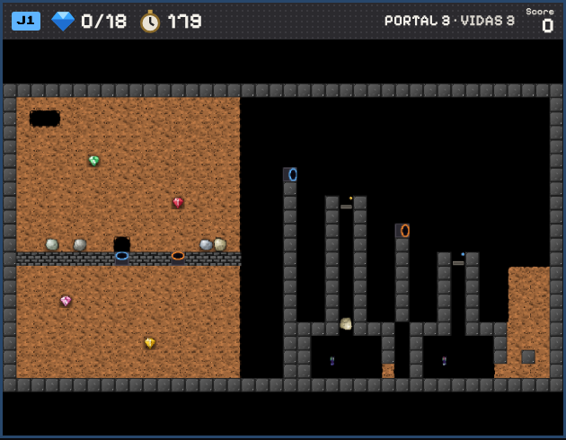

# Cuevas con portales

Los portales van **de a dos**. Cada uno es un trozo de pared con una **boca** hacia un lado, y lo que entra por la boca de uno sale por la boca del otro. Pasan niños, luciérnagas, mariposas, comelones, toneles, rocas, diamantes, nueces y barriles. Se juegan con el botón **CUEVAS CON PORTALES** del menú: son seis cuevas para probar cómo funcionan.



## Las reglas

- **Entrar:** solo por la boca, yendo hacia ella. Por los otros lados el portal es pared, y las explosiones no lo rompen.
- **Salir:** al cuadro delante de la boca del otro portal, si está libre. Si no lo está, no se pasa: lo que iba a entrar se queda donde está, y una roca se queda quieta encima.
- **Niños:** al salir cavan o recogen lo que haya en ese cuadro.
- **Enemigos:** cruzan si el cuadro de salida está vacío, y siguen hacia donde mira la boca de salida. Como los enemigos de este juego giran en el mismo lugar en espacio abierto, conviene que la boca esté al final de un pasillo.
- **Lo que cae** (rocas, diamantes, nueces, barriles, toneles) entra en un portal cuya boca mira hacia arriba, igual que si fuera un hueco. Sale según hacia dónde mire la boca de salida:
  - **hacia abajo:** sigue cayendo;
  - **hacia un lado:** avanza dos cuadros en el aire, el tercero en diagonal hacia abajo, y después cae. Así forma una parábola;
  - **hacia arriba:** sale disparado dos cuadros hacia arriba y vuelve a caer. Con dos portales de suelo rebota para siempre, como en Portal.
- **Empujar una roca** contra la boca de un portal la lanza por el otro, igual que si cayera, y el niño avanza a su lugar.
- Lo que vuela y llega a otro portal vuelve a entrar. Si choca con algo, cae.

**Letras:** `3` `4` `5` `6` son el portal azul (grupo 1) con la boca hacia arriba, la derecha, abajo y la izquierda; `7` `8` `9` `0` son el portal naranja (grupo 2). Para más pares, un mapa agrega letras propias, por ejemplo `!=portal:3:u` (grupo 3, boca hacia arriba). En el editor están en la paleta «Portales», y el editor avisa si un grupo no tiene exactamente dos portales.

## Las seis cuevas

| # | Cueva | Qué prueba | Qué se comprobó en el juego |
|---|---|---|---|
| 1 | [Al otro lado](#1) | Lo básico: los niños entran por la boca de un portal y salen por la del otro. | Un niño cruza de ida y de vuelta. La luciérnaga cruza cuando el hueco de salida queda libre. |
| 2 | [Lluvia](#2) | Dos cofres sellados, cada uno con cinco diamantes y una roca encima, están sobre portales. | Al cavar bajo el portal del techo cae un diamante, y los demás esperan. |
| 3 | [Parábola](#3) | Rocas en una repisa y dos portales en el suelo. | Con rocas soltadas en los dos portales, las dos mariposas mueren (unos 16 diamantes en sus salas). |
| 4 | [Viajeros](#4) | Dos pasillos unidos en un circuito por portales: lo que llega al final de uno sale al principio del otro. | Los enemigos cruzan unas cien veces en un minuto. Soltar la roca cuando la mariposa viene dos cuadros antes la aplasta. |
| 5 | [Rebote](#5) | Un diamante en cada par de portales del suelo, y una roca en el par del medio, rebotan para siempre: lo que cae en uno sale disparado hacia arriba del otro y vuelve a caer. | Rebotan sin parar. Con un niño sobre una boca, el diamante queda quieto sobre la otra. |
| 6 | [Lanzamiento](#6) | Tres portales en una pared, con una roca delante de cada uno y una de repuesto. | Empujando las tres rocas, las tres caen sobre sus placas y se abre la salida. |

---

<a id="1"></a>

## 1. Al otro lado

Lo básico: los niños entran por la boca de un portal y salen por la del otro. Una pared de acero parte la cueva: el portal azul lleva a la derecha y el naranja trae de vuelta, y hay diamantes a los dos lados. Una luciérnaga espera en un pasillo junto al portal de vuelta: cuando un niño abre el hueco al otro lado, ella también puede cruzar.

**Pista al entrar:** «Entra por la boca de un portal y sales por el otro. El portal azul va; el naranja vuelve.» · **diamantes:** 12

```
########################################
#...................#..................#
#.X.................#..........*.......#
#...........*.......#....*.............#
#....*..............#............*.....#
#...................4..................#
#........o..........#......o...........#
#...................#..................#
#...................#.........*........#
#.......*...........#..................#
#...................8   F .............#
#...................#..................#
#..............*....#...............*..#
#.....*.............#..................#
#...................#..................#
#.............o.....6.......*......o...#
#...................#..................#
#..12...............#..................#
#...................0.............*....#
#..........*........#...*..............#
#...................#..................#
########################################
```

---

<a id="2"></a>

## 2. Lluvia

Dos cofres sellados, cada uno con cinco diamantes y una roca encima, están sobre portales. Sus pares cuelgan del techo de la cueva, con la boca hacia abajo y tapados con tierra. Al cavar esa tierra cae un diamante, y el siguiente espera a que se recoja el anterior. Cuidado con estar debajo, y con la roca del final.

**Pista al entrar:** «Los cofres de arriba caen por los portales. Cava la tierra bajo el portal del techo... y apártate.» · **diamantes:** 12

```
########################################
#........#o#.................#o#.......#
#........#*#.................#*#.......#
#........#*#.................#*#.......#
#........#*#.................#*#.......#
#........#*#.................#*#.......#
#........#*#.................#*#.......#
#........#3#.................#7#.......#
########################################
#......................................#
#...........*..........................#
#...........................o..........#
#...............5.......9..............#
#......................................#
#.......o..............................#
#.....*............o...................#
#................................*.....#
#......................................#
#..12..................................#
#...................*..................#
#....................................X.#
########################################
```

---

<a id="3"></a>

## 3. Parábola

Rocas en una repisa y dos portales en el suelo. Una roca empujada sobre un portal sale volando de una torre: avanza dos cuadros, baja en curva y cae por un pozo hasta la sala de una mariposa. Arriba del pozo hay una placa que hace de reja: las rocas pasan y la mariposa no puede salir.

**Pista al entrar:** «Empuja rocas sobre los portales del suelo: salen volando de las torres y caen en curva.» · **diamantes:** 18

```
########################################
#................                      #
#.12.............                      #
#................                      #
#................                      #
#.....*..........                      #
#................   4                  #
#................   #                  #
#...........*....   #  #p#             #
#................   #  # #             #
#................   #  # #  8          #
#..o.o........oo.   #  # #  #          #
#WWWWWWW3WWW7WWWW   #  # #  #  #q#     #
#................   #  # #  #  # #  ...#
#................   #  # #  #  # #  ...#
#...*............   #  # #  #  # #  ...#
#................   #  # #  #  # #  ...#
#................   #### ### ### ###...#
#.........*......   ##     # #     #...#
#................   ##  B  # #  B  #.X.#
#................   ##     . #     ....#
########################################
```

---

<a id="4"></a>

## 4. Viajeros

Dos pasillos unidos en un circuito por portales: lo que llega al final de uno sale al principio del otro. Dos mariposas y una luciérnaga dan vueltas sin parar. Sobre los pasillos hay rocas, con un cuadro de tierra debajo: hay que soltarlas justo cuando pasa una mariposa.

**Pista al entrar:** «Mariposas y luciérnagas dan la vuelta por los portales. Suelta las rocas cuando pase una mariposa.» · **diamantes:** 18

```
########################################
#......................................#
#......................................#
#..................12...............*..#
#...*..................................#
#.............................*........#
#.........*............................#
#......................................#
#......................................#
#......................................#
#....o...o...o.........................#
#.#.............#......................#
#.8  B     F    6......................#
#.#.............#..........o...o...o...#
#..................*...#.............#.#
#......................4      B      0.#
#......................#.............#.#
#...................*..................#
#.......*..............................#
#...............................*......#
#...................X..................#
########################################
```

---

<a id="5"></a>

## 5. Rebote

Un diamante en cada par de portales del suelo, y una roca en el par del medio, rebotan para siempre: lo que cae en uno sale disparado hacia arriba del otro y vuelve a caer. Para frenarlo hay que pararse sobre la boca por la que saldría; entonces queda quieto sobre la otra y se recoge de lado.

**Pista al entrar:** «Lo que cae en un portal del suelo sale disparado del otro. Párate sobre una boca para frenarlo.» · **diamantes:** 7 · **letras propias:** `!=portal:3:u`

```
########################################
#......................................#
#......................................#
#.12..........................*........#
#.........*............................#
#......................................#
#...................*..................#
#......................................#
#......................................#
#......................................#
#                              o       #
#                      *               #
#       *                          *   #
#                                      #
#                                      #
#                                      #
#W..WWWW3WWWWWWW3WWWWWW7WWWWWWW7WWW!W!W#
#......................................#
#.....*.....................*..........#
#.................*..................X.#
#......................................#
########################################
```

---

<a id="6"></a>

## 6. Lanzamiento

Tres portales en una pared, con una roca delante de cada uno y una de repuesto. Empujada a un portal, la roca sale volando de una torre y cae dos cuadros más allá, sobre una placa. Con las tres placas cubiertas se abre la salida. Esta cueva no pide diamantes.

**Pista al entrar:** «Empuja las rocas a los portales de la pared: deben caer sobre las tres placas para abrir la salida.» · **diamantes:** 0 · **letras propias:** `?=portal:3:l @=portal:3:r`

```
########################################
#.........#                            #
#.........#                            #
#.12......#                            #
#.........#         4                  #
#.........#         #                  #
#........o6         #     8            #
#.WWWWWWWW#         #     #            #
#.........#         #     #    @       #
#.........#         #     #    #       #
#...o....o0         #     #    #       #
#.WWWWWWWW#         #     #    #       #
#.........#         #     #    #       #
#.........#         #     #    #       #
#........o?         #     #    #       #
#.WWWWWWWW#         #     #    #       #
#.WWWWWWWWWWWWWWWWWWWWWW_WWWWW_WWWW_WWW#
#......................................#
#......................................#
#....................................X.#
#......................................#
########################################
```

---

## Cómo está hecho

El portal es una pieza más (sólida, con una boca y un número de par) y funciona igual en cualquier mapa. Al cargar la cueva, cada portal se empareja con el siguiente de su grupo. El vuelo de lo que sale de lado o hacia arriba se guarda en cada cuadro (cuántos cuadros le quedan y hacia dónde), así que también se copia al jugar con dos celulares.

Se comprobó que las cuevas de Boulder Dash 1 y 2, las nuevas y las clásicas dan exactamente lo mismo que antes, y que dos celulares quedan iguales en las cuevas con portales.
